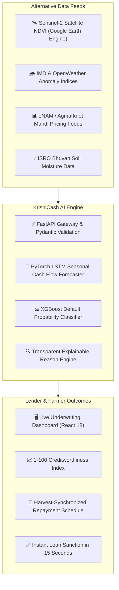
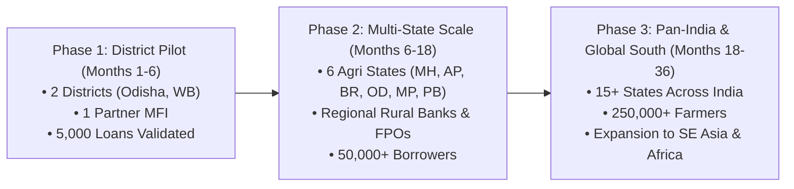

# 🌾 KrishiCash — AI-Powered Cash Flow Forecasting & Credit Risk Oracle

> **DOLPHIN TANK INDIA • SOCIAL IMPACT HACKATHON 2026**  
> **Theme:** Financial Inclusion & Livelihoods  
> **Team / Lead:** Swati Gupta (Team KrishiCash)  
> **One-Line Pitch:** *AI cash flow & risk oracle empowering rural MFIs to unlock collateral-free seasonal agricultural credit for 87M+ unbanked smallholder farmers.*

[](https://krishi-cash.vercel.app/)
[](./KrishiCash_DTI_SIH_Pitch_Deck.pdf)
[](https://github.com/swatiicfai/KrishiCash)
[](LICENSE)

---

## 📌 Executive Summary & Submission Deliverables

| Requirement | Details / Direct Link |
| :--- | :--- |
| **Hackathon Theme** | **Financial Inclusion & Livelihoods** (Dolphin Tank India / SIH 2026) |
| **Working Prototype / MVP** | 🚀 [**https://krishi-cash.vercel.app**](https://krishi-cash.vercel.app) *(No login required)* |
| **Pitch Deck (19 Slides)** | 📄 [**KrishiCash_DTI_SIH_Pitch_Deck.pdf**](./KrishiCash_DTI_SIH_Pitch_Deck.pdf) |
| **GitHub Repository** | 💻 [**github.com/swatiicfai/KrishiCash**](https://github.com/swatiicfai/KrishiCash) |
| **Demo Video Walkthrough** | 🎥 [`KrishiCash_Demo_Final.mp4`](https://youtu.be/KwSMy0TL3t8) |

---

## 🎯 Evaluation Criteria Mapping (DTI SIH 2026)

| SIH Judging Criteria | Marks | How KrishiCash Meets & Exceeds |
| :--- | :---: | :--- |
| **Problem Significance** | 15 | Solves the ₹10+ Lakh Crore informal credit bottleneck trapping 87M+ smallholder farming households in usurious moneylender debt. |
| **Understanding of Users** | 10 | Detailed personas across marginal farmers (Ramesh, 2.2 acres, Odisha) and women SHGs (Sunita Devi, Bihar) lacking bureau scores. |
| **Innovation & Differentiation** | 15 | Replaces static backward-looking CIBIL scores with forward-looking satellite NDVI, climate, and mandi price cash-flow forecasting. |
| **Solution Quality** | 15 | Multi-agent data ingestion with FastAPI, Pydantic type-safe schemas, and transparent glass-box explainability for lenders. |
| **MVP / Prototype** | 15 | Fully deployed, live interactive React dashboard with land mapping, NDVI vigor analyzer, and dynamic seasonal EMI schedules. |
| **Social Impact & SDGs** | 15 | Direct alignment with UN SDGs 1, 2, 8, and 10; projected to displace ₹165 Cr in predatory debt and lift seasonal income by 35%. |
| **Scalability** | 5 | Serverless cloud architecture ready to process 10,000+ evaluations/min across district, multi-state, and pan-India phases. |
| **Business / Sustainability Model** | 5 | Lean B2B SaaS API model (₹25–₹60/call) delivering 85% gross margins with break-even by Month 14. |
| **Responsible Technology** | 5 | Strict DPDP Act & RBI Digital Lending compliance; zero invasive smartphone snooping; algorithmic demographic fairness. |

---

## 🚨 1. The Problem: The Rural Credit Blindspot

Over **87 million** smallholder farming households and rural micro-enterprises across India operate without access to formal banking credit:

* ❌ **Bureau Data Absence:** Over **78% of rural loan applications are rejected** because marginal farmers lack traditional CIBIL scores, pay slips, or audited ITR filings.
* ❌ **Asset-Heavy Collateral Demands:** Commercial banks demand land deeds or gold collateral that tenant farmers and landless laborers do not possess.
* ❌ **Predatory Moneylender Trap:** Farmers are driven into informal debt with usurious interest rates ranging from **36% to 60% APR**, leading to perpetual debt cycles.
* ❌ **Under-Investment in Inputs:** Lack of timely liquidity before sowing seasons prevents farmers from purchasing high-yield, drought-tolerant seeds and quality organic fertilizers.

---

## 👥 2. Who is Affected? (Target Beneficiaries)

* **Marginal & Smallholder Farmers (<2 Hectares):** 86% of India's total farming population with seasonal, volatile income.
* **Tenant Cultivators & Sharecroppers:** Farmers who cultivate leased land without formal title deeds.
* **Women Self-Help Groups (SHGs) & Agri-Enterprises:** Micro-collectives engaged in dairy, poultry, and food processing unable to secure working capital.
* **Regional Rural Banks (RRBs) & MFIs:** Financial institutions suffering high origination costs and blind risks, leading to conservative lending and elevated NPAs.

---

## 💡 3. Our Solution: KrishiCash AI Oracle

KrishiCash is a **B2B AI credit risk assessment and predictive cash flow oracle** designed for Microfinance Institutions (MFIs), Regional Rural Banks (RRBs), and NBFCs.

Instead of looking backward at non-existent credit bureau files, KrishiCash synthesizes **hyper-local, forward-looking alternative data signals**:



### Core Value Pillars:
1. **100% Collateral-Free:** Underwrites loans based on predicted seasonal crop productivity and future cash liquidity.
2. **Real-Time Speed:** Delivers an institutional-grade risk assessment in **under 15 seconds**.
3. **Harvest-Aligned Dynamic Repayment:** Synchronizes loan EMI schedules to actual harvest liquidation periods rather than rigid monthly debits.
4. **Explainable AI (Glass-Box):** Gives loan officers clear rationales (e.g. *“Vegetation vigor +14%, Soil moisture normal, Local mandi prices trending up → Low Risk”*).

---

## 🧠 4. Technology Architecture & Stack

### System Flow
```
Field Agent / Loan Officer 
       │ (GPS Coordinates, Crop Type, Acreage)
       ▼
React 18 Frontend Dashboard (Vite + Tailwind CSS + Recharts)
       │ HTTP / REST APIs
       ▼
FastAPI Backend Gateway (Python 3.12 + Pydantic Contracts)
       ├── Google Earth Engine API (10m Sentinel-2 NDVI calculation)
       ├── IMD / OpenWeather API (3-month monsoon anomaly forecast)
       ├── eNAM / Agmarknet Engine (Local commodity price trends)
       ▼
Machine Learning Intelligence Layer
       ├── PyTorch LSTM Model (Predicts monthly cash flow curves)
       └── XGBoost Classifier (Estimates default probability)
       ▼
Explainable Output & Audit Ledger (Generates score, recommendation, and EMI schedule)
```

### Tech Stack Breakdown
* **Frontend:** React 18, Vite, Tailwind CSS, Recharts, Lucide Icons (Responsive Glassmorphism UI)
* **Backend:** Python 3.12, FastAPI, Uvicorn, Pydantic v2
* **Geospatial & Remote Sensing:** Google Earth Engine API, Sentinel-2 Multispectral Imagery
* **Data & Machine Learning:** PyTorch, XGBoost, Scikit-learn, NumPy, Pandas
* **Hosting & Deployment:** Vercel Serverless (Frontend), Cloud Run / Containerized API (Backend)

---

## 📈 5. Social Impact & UN SDG Alignment

### Direct UN SDG Alignment
* **SDG 1: No Poverty (Target 1.4):** Equal access to economic resources, financial services, and microfinance for vulnerable populations.
* **SDG 2: Zero Hunger (Target 2.3):** Double agricultural productivity and incomes of smallholder food producers through timely input liquidity.
* **SDG 8: Decent Work & Economic Growth (Target 8.10):** Strengthen capacity of domestic financial institutions to expand access to banking for all.
* **SDG 10: Reduced Inequalities (Target 10.2):** Promote social, economic, and financial inclusion irrespective of socio-economic status or location.

### Projected Quantitative Impact Metrics

| Metric | Year 1 (Pilot) | Year 2 (Expansion) | Year 3 (Scale) |
| :--- | :---: | :---: | :---: |
| **Smallholder Farmers Financed** | 15,000+ | 75,000+ | **250,000+** |
| **Formal Agricultural Credit Disbursed** | ₹12.5 Crores | ₹65 Crores | **₹220 Crores** |
| **Predatory Moneylender Debt Displaced** | ₹8.8 Crores | ₹48 Crores | **₹165 Crores** |
| **Farmer Net Seasonal Income Increase** | +22% | +28% | **+35%** |
| **Lender Default / NPA Reduction** | 15% Lower | 18% Lower | **22% Lower** |

---

## 🚀 6. Scalability & Growth Roadmap



* **Digital Scalability:** Built on stateless, serverless microservices capable of scaling to **50,000+ queries/minute** with sub-second response times.
* **Low-Bandwidth Optimization:** Designed to function over 2G/3G connectivity in remote rural districts.
* **Conversational Interface:** Multi-lingual WhatsApp notification bot enabling rural borrowers with basic phones to receive status alerts.

---

## 💼 7. Business Model & Financial Sustainability

### Revenue Streams (B2B SaaS)
1. **Pay-Per-Assessment API:** ₹25 to ₹60 per loan applicant charged to MFIs and rural NBFCs.
2. **Enterprise Portfolio Monitoring:** ₹50,000 to ₹1,50,000 monthly subscription for live agricultural portfolio climate risk monitoring and early default warnings.
3. **FPO & Cooperative Analytics:** Bulk health and yield forecasting dashboards for Farmer Producer Organizations.

### Unit Economics
* **Customer Acquisition Cost (CAC) per MFI:** ₹45,000
* **Average Annual Contract Value (ACV):** ₹3,80,000
* **Marginal Cost per API Assessment:** ₹4.50 (Serverless execution + API calls)
* **Gross Margin:** **85%+**
* **Break-Even Target:** Month 14 from commercial launch

---

## 🛡️ 8. Responsible AI, Ethics & Compliance

* **Zero Invasive Snooping:** Strictly **no scraping of private phone contacts, SMS logs, or browsing histories**. Farmer dignity and privacy are preserved by design.
* **Algorithmic Fairness:** Audited against demographic, gender, and caste bias; decisions reflect agronomic viability and market fundamentals exclusively.
* **Regulatory Compliance:** Engineered in full compliance with the **Digital Personal Data Protection (DPDP) Act 2023** and the **RBI Regulatory Framework for Microfinance & Digital Lending**.

---

## 💻 9. Running Locally

### Prerequisites
* Node.js 18+
* Python 3.11+

### 1. Clone & Setup
```bash
git clone https://github.com/swatiicfai/KrishiCash.git
cd KrishiCash
```

### 2. Run the Frontend Dashboard
```bash
cd frontend
npm install
npm run dev
```
Open [http://localhost:5173](http://localhost:5173) in your browser.

### 3. Run the Backend API
```bash
cd backend
pip install -r requirements.txt
uvicorn main:app --reload
```
Interactive OpenAPI documentation will be accessible at [http://localhost:8000/docs](http://localhost:8000/docs).

---

## 👥 Team & Contact

* **Founder & Lead Developer:** **Swati Gupta**
* **Email:** [swati.icfai@rediffmail.com](mailto:swati.icfai@rediffmail.com)
* **Mobile:** +91 9902829734
* **Live Product:** [https://krishi-cash.vercel.app](https://krishi-cash.vercel.app)
* **GitHub:** [https://github.com/swatiicfai/KrishiCash](https://github.com/swatiicfai/KrishiCash)

---

*“Ideas create real social impact when technology, purpose, and financial inclusion unite to empower every Indian farmer.”*
